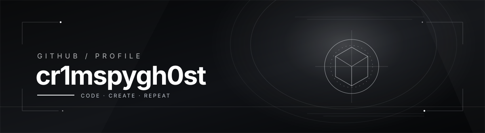

<div align="center">



<br/>

**mostly building things, occasionally breaking them, always learning.**

<br/>

[](https://github.com/cr1mspygh0st)
[](https://github.com/cr1mspygh0st)

</div>

---

### a little about me

I like figuring out how things work and turning small ideas into real projects.

- currently exploring **web development**, **Python**, and **Linux**
- interested in **automation**, **open source**, and **security fundamentals**
- into quick prototypes, useful tools, and clean interfaces
- learning by making things — not by collecting badges

### the toolbox

These are technologies I use, explore, or want to get better at. The list will change as I build more.

<div align="center">

**languages**


<br/>

**frontend**


<br/>

**backend & data**


<br/>

**workflow & infrastructure**


<br/>

**everyday tools**


</div>

### lately

```text
[ learning ]   Python · JavaScript · Linux
[ building ]   small web apps · experiments · useful scripts
[ exploring ]  APIs · databases · deployment · security basics
```

### GitHub activity

<div align="center">


<br/>


</div>

### projects

The best part of a profile is what you actually make.  
A few things I'm working on will show up here as they become ready.

<div align="center">

[**browse my repositories →**](https://github.com/cr1mspygh0st?tab=repositories)

</div>

---

<div align="center">


</div>
